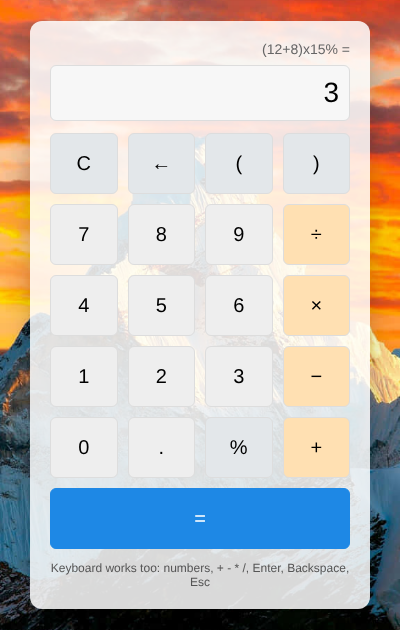

# Simple Calculator


A calculator built with plain **HTML, CSS and JavaScript**, with no frameworks.



## Features

- Addition, subtraction, multiplication, division, percentages and parentheses
- Correct operator precedence: `2 + 3 × 4 = 14`
- Negative numbers, e.g. `3 × -2`
- Floating point rounding, so `0.1 + 0.2` shows `0.3`
- Clear error messages, e.g. dividing by zero or a missing bracket
- Shows the last calculation above the result
- Keyboard support: numbers, `+ - * /`, `Enter`, `Backspace`, `Esc`
- Responsive layout and accessible labels

## No `eval()`

The first version used `eval()`, which runs any JavaScript typed into it. I replaced it with a small parser in `calculator.js`:

1. **Tokenizer**: splits the input into numbers, operators and brackets, and rejects anything else.
2. **Shunting-yard algorithm**: converts the tokens to Reverse Polish Notation, respecting precedence.
3. **Evaluation**: runs the RPN with a stack.

`calculator.js` works both in the browser and in Node, so it can be unit tested.

## Running it

Open `index.html` in a browser.

## Tests

The tests use Node's built-in test runner, so there are no dependencies to install (Node 18+):

```bash
npm test
```
